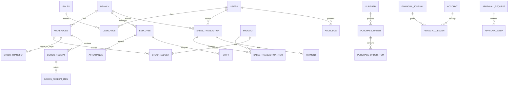

# DATABASE DESIGN DOCUMENT

Document ID: DDD-VCP-001
Version: 1.0.0
Status: Baseline
Project: VAPECORE POS
DBMS: PostgreSQL 15+
Primary Owner: Database Architect

---

## 1. Database Overview

Database VAPECORE POS dirancang untuk mendukung operasi retail enterprise, multi-cabang, multi-warehouse, auditability, dan integrity transaksi. Struktur database dibagi berdasarkan domain bisnis agar lebih mudah dikelola, di-scale, dan diperluas. Database utama adalah PostgreSQL dengan strategi append-only ledger untuk stock movement dan financial posting yang sudah dikonfirmasi.

## 2. Database Design Principles

- Single source of truth.
- Append-only ledger for stock and financial movement.
- Strong referential integrity.
- Immutable history for confirmed business action.
- Separation of duties and access control.
- Standardized timestamp and timezone handling.
- Clear separation between operational tables and reporting tables.

## 3. Database Technology

- PostgreSQL 15+
- UUID primary keys for distributed-safe identification
- JSONB for dynamic metadata and audit payloads
- Indexes on branch, warehouse, status, date, and reference keys
- Row-level security considerations for branch and role isolation

## 4. ERD Overview



## 5. Database Schema Structure

| Schema | Purpose |
|---|---|
| public | Core transactional schema |
| auth | User, role, permission, session |
| inventory | Product, stock ledger, transfer, cycle count |
| finance | Journal, ledger, cash movement |
| hr | Employee, attendance, shift, payroll |
| procurement | Supplier, PO, goods receipt, invoice |
| audit | Audit log and findings |
| workflow | Approval request and steps |
| reporting | Summary and materialized views |

## 6. Core Table Definitions

### users
| Column | Type | Constraints |
|---|---|---|
| id | UUID | PK |
| username | VARCHAR(100) | UNIQUE, NOT NULL |
| email | VARCHAR(255) | UNIQUE, NOT NULL |
| password_hash | VARCHAR(255) | NOT NULL |
| status | VARCHAR(30) | NOT NULL |
| created_at | TIMESTAMPTZ | NOT NULL |
| updated_at | TIMESTAMPTZ | NOT NULL |

### roles
| Column | Type | Constraints |
|---|---|---|
| id | UUID | PK |
| code | VARCHAR(50) | UNIQUE |
| name | VARCHAR(100) | NOT NULL |
| description | TEXT | |

### user_role
| Column | Type | Constraints |
|---|---|---|
| user_id | UUID | FK users.id |
| role_id | UUID | FK roles.id |
| branch_id | UUID | FK branches.id |
| assigned_at | TIMESTAMPTZ | NOT NULL |

### branches
| Column | Type | Constraints |
|---|---|---|
| id | UUID | PK |
| code | VARCHAR(50) | UNIQUE |
| name | VARCHAR(150) | NOT NULL |
| address | TEXT | |
| status | VARCHAR(30) | NOT NULL |
| created_at | TIMESTAMPTZ | NOT NULL |

### warehouses
| Column | Type | Constraints |
|---|---|---|
| id | UUID | PK |
| branch_id | UUID | FK branches.id |
| code | VARCHAR(50) | UNIQUE |
| name | VARCHAR(150) | NOT NULL |
| type | VARCHAR(50) | NOT NULL |
| status | VARCHAR(30) | NOT NULL |

### products
| Column | Type | Constraints |
|---|---|---|
| id | UUID | PK |
| sku | VARCHAR(100) | UNIQUE |
| barcode | VARCHAR(100) | UNIQUE |
| name | VARCHAR(200) | NOT NULL |
| category_id | UUID | FK product_categories.id |
| status | VARCHAR(30) | NOT NULL |
| base_price | NUMERIC(18,2) | NOT NULL |
| cost_price | NUMERIC(18,2) | |
| created_at | TIMESTAMPTZ | NOT NULL |

### sales_transactions
| Column | Type | Constraints |
|---|---|---|
| id | UUID | PK |
| transaction_no | VARCHAR(100) | UNIQUE, NOT NULL |
| branch_id | UUID | FK branches.id |
| cashier_id | UUID | FK users.id |
| status | VARCHAR(30) | NOT NULL |
| gross_amount | NUMERIC(18,2) | NOT NULL |
| discount_amount | NUMERIC(18,2) | DEFAULT 0 |
| net_amount | NUMERIC(18,2) | NOT NULL |
| payment_status | VARCHAR(30) | NOT NULL |
| created_at | TIMESTAMPTZ | NOT NULL |
| completed_at | TIMESTAMPTZ | |
| idempotency_key | VARCHAR(128) | |

### sales_transaction_items
| Column | Type | Constraints |
|---|---|---|
| id | UUID | PK |
| sales_transaction_id | UUID | FK sales_transactions.id |
| product_id | UUID | FK products.id |
| qty | NUMERIC(18,3) | NOT NULL |
| unit_price | NUMERIC(18,2) | NOT NULL |
| discount_amount | NUMERIC(18,2) | DEFAULT 0 |
| total_amount | NUMERIC(18,2) | NOT NULL |

### payments
| Column | Type | Constraints |
|---|---|---|
| id | UUID | PK |
| sales_transaction_id | UUID | FK sales_transactions.id |
| payment_method | VARCHAR(50) | NOT NULL |
| payment_reference | VARCHAR(200) | |
| amount | NUMERIC(18,2) | NOT NULL |
| status | VARCHAR(30) | NOT NULL |
| processed_at | TIMESTAMPTZ | |
| idempotency_key | VARCHAR(128) | |

### stock_ledger
| Column | Type | Constraints |
|---|---|---|
| id | UUID | PK |
| product_id | UUID | FK products.id |
| warehouse_id | UUID | FK warehouses.id |
| branch_id | UUID | FK branches.id |
| movement_type | VARCHAR(50) | NOT NULL |
| quantity_in | NUMERIC(18,3) | DEFAULT 0 |
| quantity_out | NUMERIC(18,3) | DEFAULT 0 |
| balance_after | NUMERIC(18,3) | NOT NULL |
| reference_type | VARCHAR(50) | NOT NULL |
| reference_id | UUID | |
| created_by | UUID | FK users.id |
| created_at | TIMESTAMPTZ | NOT NULL |
| is_reversal | BOOLEAN | DEFAULT false |

### stock_adjustments
| Column | Type | Constraints |
|---|---|---|
| id | UUID | PK |
| warehouse_id | UUID | FK warehouses.id |
| product_id | UUID | FK products.id |
| adjustment_type | VARCHAR(50) | NOT NULL |
| quantity_delta | NUMERIC(18,3) | NOT NULL |
| reason | TEXT | NOT NULL |
| approved_by | UUID | FK users.id |
| status | VARCHAR(30) | NOT NULL |
| created_at | TIMESTAMPTZ | NOT NULL |

### stock_transfers
| Column | Type | Constraints |
|---|---|---|
| id | UUID | PK |
| from_warehouse_id | UUID | FK warehouses.id |
| to_warehouse_id | UUID | FK warehouses.id |
| request_by | UUID | FK users.id |
| approved_by | UUID | FK users.id |
| status | VARCHAR(30) | NOT NULL |
| requested_at | TIMESTAMPTZ | NOT NULL |
| approved_at | TIMESTAMPTZ | |

### cycle_counts
| Column | Type | Constraints |
|---|---|---|
| id | UUID | PK |
| warehouse_id | UUID | FK warehouses.id |
| counted_by | UUID | FK users.id |
| status | VARCHAR(30) | NOT NULL |
| discrepancy_qty | NUMERIC(18,3) | |
| created_at | TIMESTAMPTZ | NOT NULL |

### financial_journal
| Column | Type | Constraints |
|---|---|---|
| id | UUID | PK |
| journal_no | VARCHAR(100) | UNIQUE, NOT NULL |
| branch_id | UUID | FK branches.id |
| journal_type | VARCHAR(50) | NOT NULL |
| source_type | VARCHAR(50) | NOT NULL |
| source_id | UUID | |
| description | TEXT | |
| total_amount | NUMERIC(18,2) | NOT NULL |
| status | VARCHAR(30) | NOT NULL |
| posted_at | TIMESTAMPTZ | |

### financial_ledger
| Column | Type | Constraints |
|---|---|---|
| id | UUID | PK |
| journal_id | UUID | FK financial_journal.id |
| account_code | VARCHAR(50) | NOT NULL |
| debit_amount | NUMERIC(18,2) | DEFAULT 0 |
| credit_amount | NUMERIC(18,2) | DEFAULT 0 |
| balance_after | NUMERIC(18,2) | NOT NULL |
| created_at | TIMESTAMPTZ | NOT NULL |

### purchase_orders
| Column | Type | Constraints |
|---|---|---|
| id | UUID | PK |
| po_no | VARCHAR(100) | UNIQUE |
| supplier_id | UUID | FK suppliers.id |
| branch_id | UUID | FK branches.id |
| status | VARCHAR(30) | NOT NULL |
| total_amount | NUMERIC(18,2) | NOT NULL |
| created_by | UUID | FK users.id |
| created_at | TIMESTAMPTZ | NOT NULL |

### goods_receipts
| Column | Type | Constraints |
|---|---|---|
| id | UUID | PK |
| gr_no | VARCHAR(100) | UNIQUE |
| po_id | UUID | FK purchase_orders.id |
| warehouse_id | UUID | FK warehouses.id |
| received_by | UUID | FK users.id |
| status | VARCHAR(30) | NOT NULL |
| received_at | TIMESTAMPTZ | |

### audit_log
| Column | Type | Constraints |
|---|---|---|
| id | UUID | PK |
| entity_type | VARCHAR(100) | NOT NULL |
| entity_id | UUID | NOT NULL |
| action | VARCHAR(50) | NOT NULL |
| actor_id | UUID | FK users.id |
| payload | JSONB | |
| created_at | TIMESTAMPTZ | NOT NULL |
| ip_address | VARCHAR(64) | |

## 7. Primary Keys, Foreign Keys, Constraints

- Every table uses UUID for primary key unless explicit alternative required.
- Foreign keys enforce referential integrity.
- Transaction records are not hard-deleted; they move status state or require reversal record.
- Unique constraints are applied to codes such as transaction_no, sku, barcode, journal_no, po_no.
- Cross-table validation at application layer ensures branch and warehouse consistency.

## 8. Indexing Strategy

| Table | Indexing Strategy |
|---|---|
| sales_transactions | idx_txn_branch_date_status |
| sales_transaction_items | idx_item_txn_product |
| stock_ledger | idx_stock_prod_warehouse_date |
| financial_ledger | idx_ledger_account_date |
| audit_log | idx_audit_entity_action_date |
| purchase_orders | idx_po_supplier_status |
| users | idx_user_email_username |
| warehouses | idx_warehouse_branch_code |

## 9. Relationship Definitions

- One branch contains many warehouses.
- One sales transaction contains many sale items and payments.
- One product generates many stock ledger entries over time.
- One warehouse can be source or target of many stock transfer records.
- One purchase order can generate many goods receipts.
- One financial journal contains many ledger rows.
- One audit record can relate to many entities through entity_type and entity_id.

## 10. Data Types

| Type | Use Cases |
|---|---|
| UUID | PK and entity IDs |
| VARCHAR | Code, names, statuses |
| NUMERIC(18,2) | Currency values |
| NUMERIC(18,3) | Quantities |
| TIMESTAMPTZ | Business timestamps |
| JSONB | Audit payload and dynamic metadata |
| TEXT | Notes, reasons, descriptions |

## 11. Transaction Strategy

- Use database transaction for POS sale, payment settlement, and journal posting.
- Use outbox/event emission after commit for cross-domain updates.
- Use idempotency keys for payment and stock updates.
- Commit only after validation and business rules succeed.

## 12. Data Integrity

- Business validation enforced in backend and DB constraints where possible.
- Negative quantity rules enforced by service logic and triggers.
- Journal and stock movement cannot be modified after confirmation without reversal entries.
- Price and discount validation must be performed before final transaction commit.

## 13. Data Retention

| Data Type | Retention |
|---|---|
| Transaction data | 7 years |
| Audit log | 10 years |
| Login/session metadata | 1 year |
| Temporary sync queue | 30 days |
| Reporting snapshot | 2 years |

## 14. Backup and Recovery

- Daily full backup.
- Continuous WAL archiving.
- PITR support for reduced recovery point objective.
- Recovery test every quarter.

## 15. Database Migration

- Use versioned migration scripts.
- Each migration includes rollback plan.
- Run migration validation in staging before production deployment.
- Maintain naming convention: YYYYMMDDHHMM_description.sql.

## 16. Audit Data Architecture

- All critical changes store actor_id, timestamp, object data, old/new values when relevant.
- Audit log remains append-only and cannot be modified by normal users.
- Internal audit can read and analyze but not alter original records.

## 17. Seed Data Strategy

- System seed: roles, permissions, core admin users, status codes.
- Country, currency, payment method seed values.
- Branch and warehouse seed data per environment.
- Reference data loaded through controlled migration or seed scripts.

## 18. Example DDL

```sql
CREATE TABLE public.sales_transactions (
  id UUID PRIMARY KEY,
  transaction_no VARCHAR(100) NOT NULL UNIQUE,
  branch_id UUID NOT NULL,
  cashier_id UUID NOT NULL,
  status VARCHAR(30) NOT NULL,
  gross_amount NUMERIC(18,2) NOT NULL,
  discount_amount NUMERIC(18,2) NOT NULL DEFAULT 0,
  net_amount NUMERIC(18,2) NOT NULL,
  payment_status VARCHAR(30) NOT NULL,
  created_at TIMESTAMPTZ NOT NULL DEFAULT NOW(),
  completed_at TIMESTAMPTZ,
  idempotency_key VARCHAR(128)
);

CREATE TABLE public.stock_ledger (
  id UUID PRIMARY KEY,
  product_id UUID NOT NULL,
  warehouse_id UUID NOT NULL,
  branch_id UUID NOT NULL,
  movement_type VARCHAR(50) NOT NULL,
  quantity_in NUMERIC(18,3) NOT NULL DEFAULT 0,
  quantity_out NUMERIC(18,3) NOT NULL DEFAULT 0,
  balance_after NUMERIC(18,3) NOT NULL,
  reference_type VARCHAR(50) NOT NULL,
  reference_id UUID NOT NULL,
  created_by UUID NOT NULL,
  created_at TIMESTAMPTZ NOT NULL DEFAULT NOW(),
  is_reversal BOOLEAN NOT NULL DEFAULT false
);
```

## 19. Key Constraints and Integrity Rules

- `quantity_in` and `quantity_out` cannot both be positive in a single ledger event.
- `balance_after` must equal previous balance ± delta.
- `sales_transaction.net_amount` = `gross_amount - discount_amount`.
- `payment.amount` must be > 0.
- `status` must use valid enumerations per domain policy.
- `branch_id` and `warehouse_id` should be consistent for stock movement records.

## 20. Risk and Design Considerations

- Need synchronization rules for multi-branch reporting and reconciliation.
- Need explicit reversal policies for journal entries to avoid double posting.
- Need tenant isolation if multi-company deployment is required later.
- Need branch-scoped access logic for shared inventory and warehouse references.

---

## 21. References

- MPS-VCP-001
- SAD-VCP-001
- SRS-VCP-001
