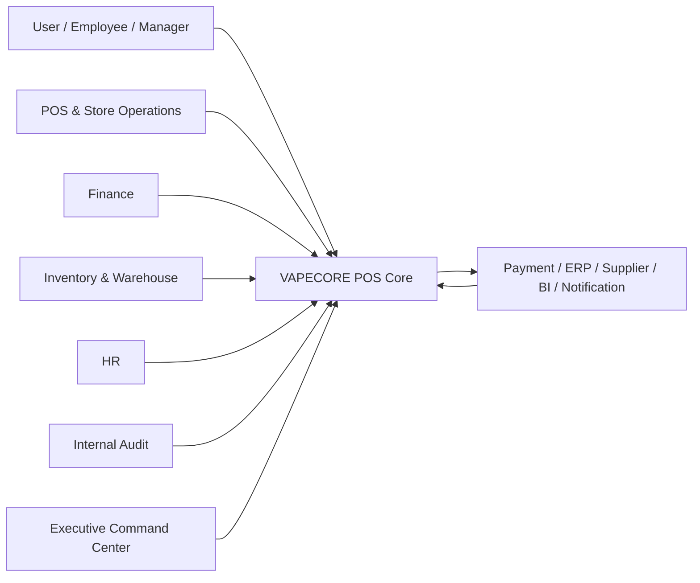
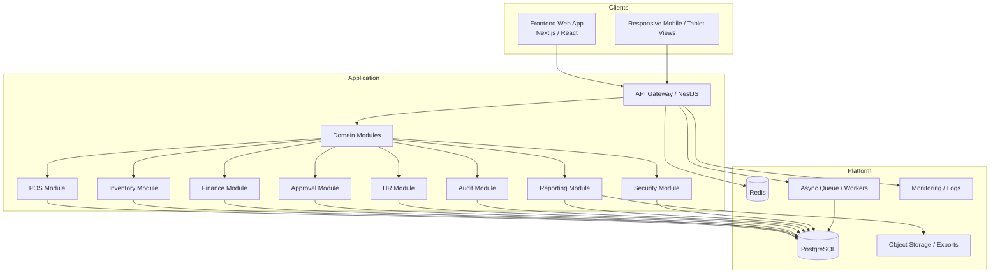
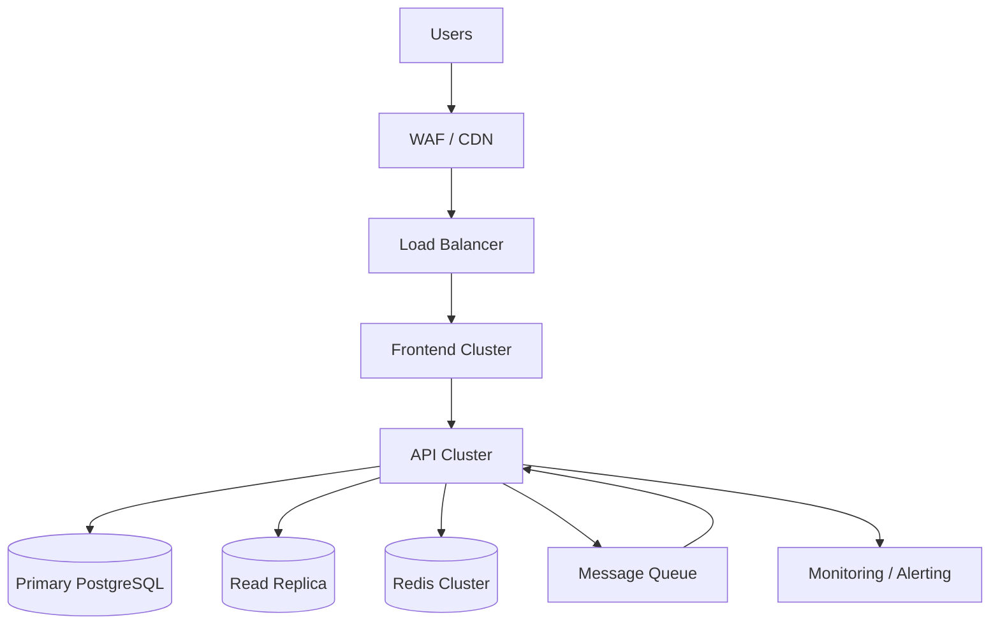
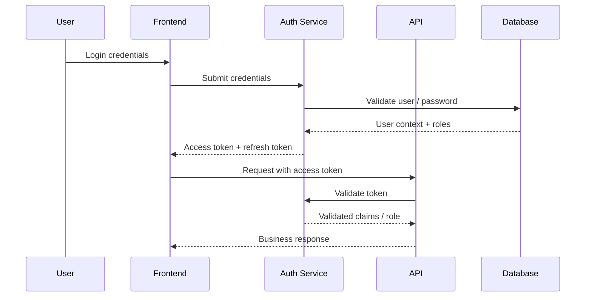
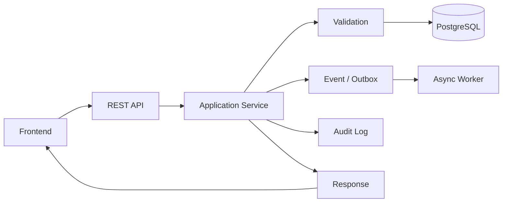

# SYSTEM ARCHITECTURE DOCUMENT

Document ID: SAD-VCP-001
Version: 1.0.0
Status: Baseline
Project: VAPECORE POS
Owner: Enterprise Solution Architecture Team
Approval: Project Owner / Management
Baseline Reference: MPS-VCP-001

---

## 1. Document Control

| Field | Value |
|---|---|
| Document ID | SAD-VCP-001 |
| Document Name | System Architecture Document |
| Project | VAPECORE POS |
| Baseline Version | 1.0.0 |
| Status | Baseline |
| Language | Bahasa Indonesia |
| Primary Owner | Enterprise Solution Architect |
| Reviewers | System Architect, Backend Architect, Frontend Architect, Database Architect, Security Architect |
| Approval | Project Steering Committee |

### Revision History

| Version | Date | Description | Author |
|---|---|---|---|
| 1.0.0 | 2026-10-30 | Initial detailed architecture baseline | Architecture Team |

---

## 2. Purpose and Scope

Dokumen ini mendefinisikan arsitektur sistem VAPECORE POS untuk mendukung operasi retail enterprise dengan skala multi-cabang, multi-warehouse, multi-user, serta kebutuhan audit, keamanan, dan integrasi. Arsitektur dibuat sebagai modular monolith yang dapat berkembang menjadi arsitektur mikroservice jika kebutuhan bisnis dan volume operasional mencapai titik yang mengharuskan pemisahan domain yang lebih independen.

Tujuan utama dokumentasi ini adalah memastikan seluruh tim dapat memahami:
- batas domain bisnis,
- hubungan antar modul,
- aliran data dan event,
- model keamanan,
- model deployment,
- dan pola pengembangan yang konsisten.

## 3. System Overview

VAPECORE POS adalah sistem enterprise retail operating system yang mengintegrasikan bidang-bidang berikut:
- Point of Sale,
- Product Management,
- Inventory Management,
- Stock Control & Cycle Count,
- Warehouse Management,
- Distribution & Transfer,
- Finance,
- Human Resources,
- Internal Audit,
- Procurement,
- Branch Management,
- Approval Workflow,
- Reporting,
- dan Security Administration.

Sistem ini bukan sekadar perangkat kasir, tetapi infrastruktur operasional yang menghubungkan transaksi bisnis, data master, keuangan, perilaku audit, dan visibilitas eksekutif. Setiap transaksi yang berdampak pada stok, keuangan, atau kewenangan harus tercatat, dapat dilacak, dan tidak dapat diubah tanpa mekanisme koreksi yang terkontrol.

### 3.1 Business Drivers

- Konsolidasi data seluruh cabang menjadi satu sumber kebenaran.
- Pengendalian stok, kas, dan jurnal dengan validasi yang lebih kuat.
- Peningkatan visibilitas eksekutif terhadap performa bisnis.
- Standarisasi alur approval dan pemisahan tugas.
- Keamanan data dan audit trail yang andal.
- Kemampuan implementasi scalable ke depan untuk ekspansi bisnis.

## 4. Architecture Objectives

1. Menyediakan satu platform operasional yang menghubungkan semua modul utama.
2. Menjamin integritas transaksi, stok, dan akun keuangan.
3. Menyediakan traceability untuk setiap perubahan penting.
4. Menegakkan backend authorization dan audit trail secara konsisten.
5. Menggunakan pola arsitektur yang dapat diperluas tanpa menurunkan reliabilitas.
6. Menjaga performa untuk operasi harian dan dashboard eksekutif.
7. Mencegah konflik data antar cabang maupun divisi.

## 5. Architecture Principles

- Single source of truth untuk semua data bisnis utama.
- Append-only ledger untuk stok dan transaksi keuangan yang telah dikonfirmasi.
- Separation of duties dan approval-based control.
- Least privilege access untuk setiap role.
- Secure by default dengan backend enforcement.
- API-first integration untuk segala komunikasi antar sistem.
- Observability, monitoring, dan auditability by design.
- Modular monolith sebagai baseline, dengan domain boundary yang jelas.

## 6. Architectural Context

### 6.1 External Actors

| Actor | Description |
|---|---|
| Store Employee | Cashier, sales staff, operator toko |
| Store Manager | Pengelola toko dan approval lokal |
| Branch Manager | Supervisi cabang |
| Finance Staff | Rekonsiliasi, jurnal, laporan keuangan |
| Procurement Staff | Purchase order, supplier, receiving |
| Warehouse Staff | Receiving, stock transfer, cycle count |
| HR Staff | Attendance, shift, payroll |
| Internal Auditor | Audit independent |
| Executive | Dashboard dan monitoring KPI |
| System Administrator | User, role, policy, security configuration |
| External Providers | Payment gateway, supplier integration, third-party services |

### 6.2 System Context Diagram

## 7. High-Level Architecture

### 7.1 High-Level Diagram

## 8. Application Architecture

### 8.1 Domain Modules

| Module | Responsibility | Primary Business Objects |
|---|---|---|
| POS | Sales, payment, cashier close | sales_transaction, payment, shift, receipt |
| Product | Product master, variant, promotion | product, sku, price_list |
| Inventory | Stock visibility and valuation | inventory_item, stock_balance |
| SCT | Stock control and cycle count | stock_ledger, cycle_count, discrepancy |
| Warehouse | Receiving, transfer, storage | warehouse, warehouse_bin, stock_transfer |
| Finance | Journals, ledger, AP/AR, closing | journal, ledger, cash_move |
| HR | Employee, shift, attendance, payroll | employee, attendance, payroll |
| Procurement | Supplier, PO, GR, invoice | supplier, purchase_order, goods_receipt |
| Audit | Audit review and compliance | audit_log, finding, corrective_action |
| Approval | Routing and escalation | approval_request, approval_step |
| Reporting | Dashboard and analytics | report_definition, report_snapshot |
| Security | Auth, RBAC, session, audit role | user, role, permission, policy |

### 8.2 Module Boundary Rules

- Batas domain harus mengikuti tanggung jawab bisnis, bukan teknologi.
- Shared kernel hanya untuk referensi umum seperti master status, unit, currency, timezone.
- Interaksi antar domain melalui service interfaces atau API, bukan akses langsung tabel antar modul.
- Semua perintah bisnis yang mengubah data utama harus menghasilkan event atau audit record.

## 9. Frontend Architecture

### 9.1 Tech Stack

- Next.js
- React
- TypeScript
- Tailwind CSS
- State management: React Query + local state patterns
- Component library based on design tokens

### 9.2 Presentation Layers

1. Shell and navigation layer
2. Module pages and screens
3. Shared components and widgets
4. API integration layer
5. Validation and permission helpers

### 9.3 Frontend Design Guidelines

- Dark graphite / charcoal primary theme.
- Emerald accent for success, completion, and primary actions.
- High information density for dashboard and operational tables.
- Real-time data refresh where safe.
- High readability for executive data and audit review.

## 10. Backend Architecture

### 10.1 Tech Stack

- NestJS
- TypeScript
- PostgreSQL
- Redis
- Queue system for async tasks
- Observability with logs, metrics, trace IDs

### 10.2 Backend Layers

- API layer
- Application service layer
- Domain service layer
- Repository / data access layer
- Event publisher / outbox layer
- Security and authorization layer
- Audit interceptor and logging layer

### 10.3 Core Patterns

- Command and query separation
- Transactional domain services
- Idempotency for financial and stock operations
- Event-driven integration for nonblocking workflows
- Structured error and validation handling

## 11. Database Architecture

### 11.1 Design Intent

- PostgreSQL sebagai database utama untuk transaksi operasional.
- Append-only ledger untuk stock movement dan financial posting yang sudah dikonfirmasi.
- Struktur schema dipisahkan berdasarkan domain.
- Data historis disimpan untuk audit dan analitik.

### 11.2 Storage Characteristics

- Transactional tables for daily operations
- Reference tables for master data
- Ledger tables for immutable history
- Summary tables or materialized views for dashboards

## 12. Infrastructure Architecture

### 12.1 Core Components

| Component | Purpose |
|---|---|
| App Server | Host API and web application |
| PostgreSQL | Operational and analytical database |
| Redis | Cache, session, queue support |
| Object Storage | Export reports and file documents |
| Monitoring Stack | Logs, traces, metrics |
| CI/CD Runner | Automated validation and deployment |

### 12.2 Deployment Topology

- Environment separation: development, staging, production.
- Load balancing for frontend and API.
- Database failover for resiliency.
- Controlled ingress and private networking for sensitive components.

## 13. Cloud Deployment Architecture

## 14. Integration Architecture

### 14.1 External Integrations

- Payment providers
- Supplier and procurement systems
- Accounting / ERP sync
- Notification services
- Reporting export services

### 14.2 Integration Principles

- Secure and authenticated integration only.
- Idempotent processing for payment and stock movement events.
- Retry mechanism and DLQ for asynchronous jobs.
- Event schema versioning and contract review.

## 15. Authentication Architecture

- JWT-based authentication
- Refresh token rotation
- Rely on backend to validate role and scope
- MFA required for executive, finance, admin, audit roles
- Session IDs and device logging to support anomaly detection

### 15.1 Auth Flow

## 16. Authorization Architecture

- RBAC per module and feature
- Scope-based authorization by branch, warehouse, and department
- Resource ownership enforcement for personal and transactional data
- Frontend protection for UX only, not as security control

### 16.1 Authorization Matrix (Example)

| Role | Module Access |
|---|---|
| Cashier | POS and own shift only |
| Store Manager | Store dashboard, stock evaluation, local approvals |
| Finance Manager | Finance and reconciliation |
| Warehouse Manager | Receiving, transfer, cycle count |
| Internal Auditor | Read-only audit and supporting records |
| Executive | Dashboard and KPI access |
| System Admin | User configuration, roles, policies |

## 17. Data Flow Architecture

### 17.1 General Operational Data Flow

### 17.2 Transaction Flow Example

- Sales created in POS UI.
- API validates stock, user permission, payment state.
- Service writes sales transaction and revenue snapshot.
- Ledger and stock movement are created as separate records.
- Events emitted to finance, reporting, and notification systems.
- Audit log generated for each step.

## 18. Event & Notification Architecture

### 18.1 Event Categories

| Event | Source | Consumers | Impact |
|---|---|---|---|
| sales.completed | POS | Finance, BI, Notification | Revenue and stock reconciliation |
| stock.moved | Inventory | Warehouse, Audit, BI | Real-time stock visibility |
| approval.requested | Workflow | Manager approver | Decision queue |
| payment.failed | Payment gateway | Finance, Ops | Reconciliation and retries |
| low.stock | Inventory threshold | Store manager | Restock action |

### 18.2 Notification Model

- In-app notifications for internal users.
- Email and push for critical business alerts.
- Notification event includes entity type, reference ID, and urgency level.

## 19. Logging and Monitoring Architecture

- Structured logs with correlation ID and user context.
- Metrics for application health, API latency, and DB performance.
- Trace ID across API and queue calls.
- Alerts for payment failure, stock anomalies, security events, and failed approvals.

## 20. Scalability Strategy

### 20.1 Scale Levers

- Horizontal scaling for API layer.
- Read replicas for analytics/reporting.
- Redis for cache and queue support.
- Partitioning by business domain or branch when required.
- Async worker model for nonblocking process completion.

### 20.2 Scalability Drivers

- number of branches
- total transactions per day
- number of concurrent readers/report generators
- stock and financial movement frequency

## 21. Fault Tolerance Strategy

- Retry logic for transient external failures.
- Dead-letter queue for failed async work.
- Transaction boundaries for core business processes.
- Safe fallback mode for noncritical operations.
- Alert on repeated failures by component.

## 22. Disaster Recovery Architecture

- PostgreSQL backup and WAL archiving.
- Recovery point objective determined by business requirement.
- Warm standby or replicated environment for critical downtime.
- Disaster recovery playbook and restoration checklist.

## 23. Offline and Synchronization Architecture

### 23.1 Use Cases

- Store connectivity loss
- Offline payment or local transaction queue
- Batch synchronization after recovery

### 23.2 Principles

- Local queue with retry and deduplication.
- Transaction timestamps and origin IDs used for conflict resolution.
- Final reconciliation when connectivity is restored.
- Offline events must still be audited and synced with original references.

## 24. Architecture Decision Records (ADR)

| ADR ID | Decision | Status |
|---|---|---|
| ADR-001 | Modular monolith as initial architecture | Accepted |
| ADR-002 | PostgreSQL as primary database | Accepted |
| ADR-003 | Next.js + NestJS as baseline technology | Accepted |
| ADR-004 | Append-only stock and financial ledger | Accepted |
| ADR-005 | Backend auth and authorization are mandatory | Accepted |
| ADR-006 | Event-driven integration for asynchronous workflows | Accepted |
| ADR-007 | API-first integration with external systems | Accepted |
| ADR-008 | Multi-environment deployment baseline | Accepted |

## 25. Risks and Open Decisions

| ID | Risk / Decision Needed | Status |
|---|---|---|
| RSK-001 | Cloud provider final selection | TBD |
| RSK-002 | Offline POS policy and sync design | TBD |
| RSK-003 | Approval thresholds per department | TBD |
| RSK-004 | Payroll scope inclusion | TBD |
| RSK-005 | Multi-company / tenant configuration | TBD |
| RSK-006 | Final retention policy | TBD |

## 26. Non-Negotiable System Constraints

- Tidak ada penghapusan permanen atas transaksi yang sudah dikonfirmasi.
- Semua perubahan data sensitif harus tercatat.
- Backend enforcement wajib diterapkan sebelum operasi final.
- Transaksi keuangan dan stok harus mengikuti pola append-only dan reversibility yang terukur.
- Sistem harus memberi ruang untuk audit independent.

## 27. References

- MPS-VCP-001
- AGENT.md
- SRS-VCP-001
- DDD-VCP-001
- API-VCP-001

## 28. Glossary

- POS: Point of Sale
- RBAC: Role-Based Access Control
- ADR: Architecture Decision Record
- SLA: Service Level Agreement
- RPO: Recovery Point Objective
- RTO: Recovery Time Objective
