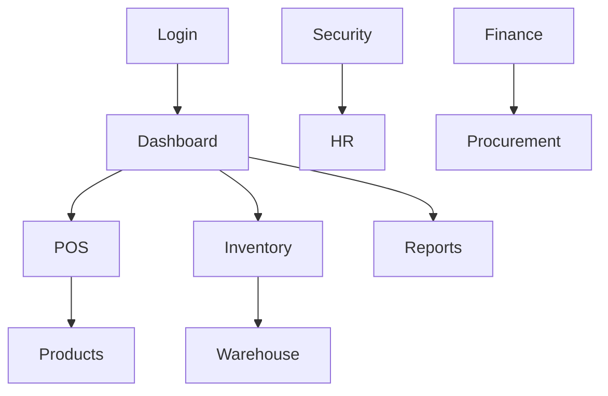
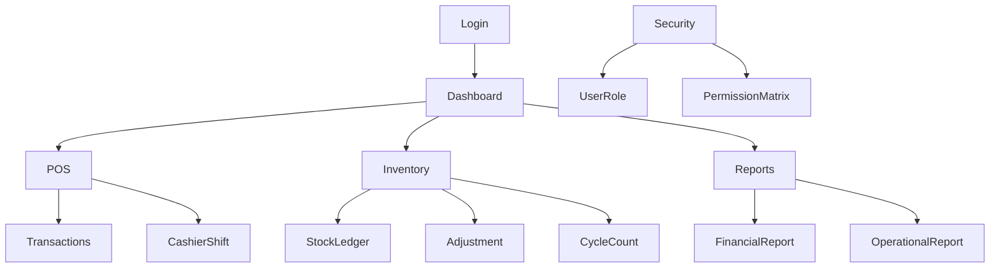

# UI/UX DESIGN SYSTEM

Document ID: UX-VCP-001
Version: 1.0.0
Status: Baseline
Project: VAPECORE POS
Owner: UI/UX Design Lead

---

## 1. Design Philosophy

VAPECORE POS menghadirkan antarmuka enterprise yang kuat, cepat, jelas, dan konsisten untuk kebutuhan operasional harian maupun monitoring eksekutif. Fokus utama adalah menyajikan informasi dalam tingkat kepadatan tinggi tanpa menimbulkan kebingungan visual, terutama untuk user yang bekerja di lini operasional dan manajerial.

## 2. Design Principles

- Clarity before decoration.
- High information density without clutter.
- Optimize for operational speed and accuracy.
- Clear separation between roles and actions.
- Consistency in layout, patterns, and validation states.
- Immediate feedback for success, error, and approval requirements.

## 3. Brand Identity

- Brand personality: professional, modern, data-driven.
- Visual tone: dark graphite / charcoal foundation.
- Accent color: emerald green for success, actions, and key indicators.
- Goal: enterprise trust and operational confidence.

## 4. Color System

| Role | Color | Usage |
|---|---|---|
| Background | #111827 | Main canvas |
| Surface | #1F2937 | Cards, panels, tables |
| Primary Accent | #10B981 | CTA and active states |
| Success | #34D399 | Completed status |
| Warning | #F59E0B | Alerts and pending review |
| Danger | #EF4444 | Reject / invalid / risk |
| Text Primary | #F9FAFB | Main text |
| Text Secondary | #9CA3AF | Secondary text |
| Border | #374151 | Dividers and input outline |

## 5. Typography

- Font family: Inter, Segoe UI, sans-serif
- Heading scale: H1 32, H2 24, H3 20, H4 16
- Body text 14-16
- UI labels 12-13
- Status text with uppercase or compact letter spacing where needed

## 6. Spacing System

Base spacing unit: 4px

| Token | Value |
|---|---|
| xs | 4 |
| sm | 8 |
| md | 12 |
| lg | 16 |
| xl | 24 |
| 2xl | 32 |
| 3xl | 40 |
| 4xl | 48 |

## 7. Layout Grid

- Desktop: 12-column grid
- Tablet: 8-column grid
- Mobile: 4-column grid
- Standard page margin: 24px
- Panels use consistent row and column spacing

## 8. Responsive Design

- Desktop optimized for executive dashboard and operational control.
- Tablet optimized for warehouse and store management tasks.
- Mobile optimized for alerts, approvals, and summary checks.

## 9. Component Library

- Data table
- Form input
- Select dropdown
- Date range picker
- Modal dialog
- Toast notification
- Tabs and filters
- Status badge
- Progress indicator
- Confirmation prompt
- Empty state component
- Loading skeleton

## 10. Navigation Structure

## 11. Dashboard Design

- KPI cards at top with stable value labels and trend indicator
- Grid layout for revenue, profit, stock discrepancy, cash variance, approval queue
- Filters by date, branch, department, warehouse, and status
- Toolbars for export, refresh, and drilldown

## 12. Table Design

- Sticky column headers
- Hover state for rows
- Filter chips and search input
- Compact density for operational tables
- Sort icon and highlight for active sorting
- Export actions in toolbar

## 13. Form Design

- Labels above inputs
- Required field indicator
- Inline validation message
- Error message placement below field
- Save / cancel actions aligned with user flow
- Input states: default, focus, success, error, disabled

## 14. Modal and Dialog

- Confirmation dialogs for critical actions
- Reason field for approval and adjustment actions
- Payment confirmation for refunds and close shift
- Large modal for long form entry and review data
- Escape and click-outside behavior in line with standard usability

## 15. Notification System

| Type | Usage | Style |
|---|---|---|
| Success | Completed action | Green |
| Warning | Threshold alert | Amber |
| Error | Rejected action | Red |
| Info | Guidance | Blue |
| Neutral | Background status | Gray |

## 16. Loading States

- Skeleton blocks for tables and cards
- Progress spinner for asynchronous processing
- Button loader for submit and approval actions
- Full page loading only when required by data dependency

## 17. Empty States

- Display helpful message and primary action
- Example: no products found, no approval request, no cash transaction history
- Include action suggestions where relevant

## 18. Error States

- Inline field validation for user-entry mistakes
- Full page fallback state for critical blocks
- Retry action for failed API calls
- Transparent error copy without exposing internal system details

## 19. Accessibility

- WCAG AA contrast baseline
- Keyboard navigation for all interactive elements
- Labels associated with inputs and actions
- Clear focus indicator and logical tab order
- Support for screen readers and semantic HTML

## 20. UI Interaction Rules

1. Critical actions require confirmation dialog.
2. Unauthorized actions should be hidden or disabled based on backend permissions.
3. UI must reflect backend validation in real time.
4. Sensitive actions must show a clear summary before final submission.
5. All major state changes must result in visible toast or status update.

## 21. Page Catalog

| Page ID | Page Name | User Roles | Purpose |
|---|---|---|---|
| UX-001 | Dashboard | Executive, Manager | KPI overview |
| UX-002 | POS Checkout | Cashier | Sales transaction |
| UX-003 | Product Master | Product Manager | Maintain product catalog |
| UX-004 | Inventory Overview | Store Manager | Inventory status |
| UX-005 | Stock Adjustment | Stock Control | Correction workflow |
| UX-006 | Warehouse Transfer | Warehouse | Transfer approval |
| UX-007 | Finance Journal | Finance | Journal management |
| UX-008 | Approval Center | Manager | Approval queue |
| UX-009 | Audit Trail | Internal Audit | Investigative view |
| UX-010 | User Role Management | Admin | Role and permission setup |

## 22. Sitemap

## 23. Design Validation

- Usability tests with cashier, warehouse, manager, and finance roles
- Validate task completion speed and clarity of decision points
- Confirm consistency of approval and confirmation patterns across modules
- Review error density and accessibility compliance before release

## 24. Design System Standards

- Reusable layouts and spacing tokens
- Standardized state styling
- Unified action hierarchy
- Shared filter, table, and form patterns across all domains

---

## 25. References

- MPS-VCP-001
- AGENT.md
- SAD-VCP-001
- SRS-VCP-001
